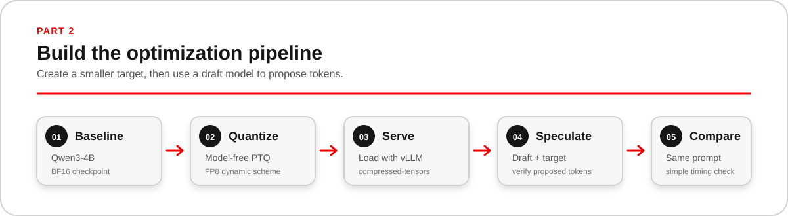
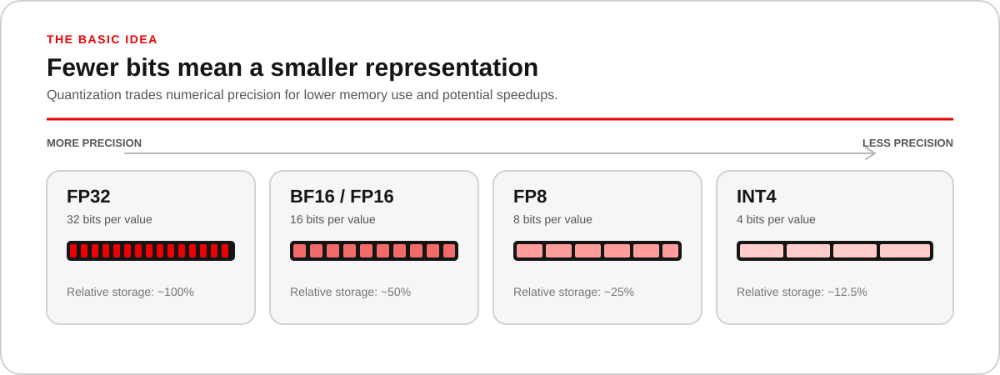
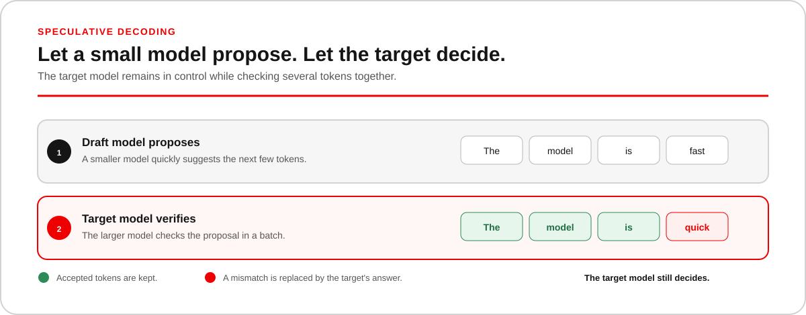

# vLLM Zero to Hero: Optimize

### *This is part two in a four part series. Follow the vLLM Zero to Hero [campaign path](https://github.com/red-hat-ai-dev/vLLM-zero-to-hero-overview) to learn more.*

Okay, so you've officially become an inference mastermind, serving and talking to your own locally hosted model. 
What's next from here?

Of course, now that we're able to talk to our model, we don't want to wait around so long to read the generated responses.
That's where model optimization comes in! In this section, we're going to go over how _Quantization_ and _Speculative Decoding_
can help speed up a model!

This is how the pipeline is going to look:
you start with a baseline model, create a compressed checkpoint, serve it with
vLLM, and add a draft model for speculative decoding.



## What you will learn

- What quantization changes inside a model
- How to use LLM Compressor's model-free PTQ pathway
- How to serve a baseline model and a compressed model with vLLM
- How speculative decoding uses a draft model and a target model together
- How to make a small before-and-after comparison

This tutorial is designed for anyone interested in modern AI inference. You do
not need to be a machine learning researcher or an inference specialist. The
commands are copyable, and the explanations give you the context behind each
step.

## The model used in this part

Part 1 uses Qwen3.5-2B to provide a small first serving experience. Part 2 uses
[Qwen3-4B](https://huggingface.co/Qwen/Qwen3-4B) so the optimization path can
use matching Red Hat AI artifacts:

- [RedHatAI/Qwen3-4B-FP8-dynamic](https://huggingface.co/RedHatAI/Qwen3-4B-FP8-dynamic)
- [RedHatAI/Qwen3-4B-speculator.dspark](https://huggingface.co/RedHatAI/Qwen3-4B-speculator.dspark)

The model is still small enough for a learning workflow, while being large
enough to make the memory and serving tradeoffs visible.

## Quantization, in plain language

Model weights are numbers. A model normally stores those numbers using a
format such as BF16 or FP16. Quantization represents the numbers with fewer
bits, such as FP8 or INT4, so the checkpoint takes less space and the hardware
can often move and process values more efficiently.

Quantization is a tradeoff: fewer bits can mean less memory and better
throughput, but an aggressive scheme can change the model's output quality.
Post-training quantization (PTQ) applies that transformation after the model
has already been trained. This tutorial uses a data-free FP8 dynamic scheme,
so it does not require a calibration dataset.



The sizes in this diagram are approximate storage comparisons for the values
themselves. Real checkpoints also contain scales, metadata, and layers that may
remain at a higher precision. This tutorial focuses on FP8 dynamic
quantization, which sits in the middle of the precision tradeoff.

### Why model-free PTQ?

LLM Compressor's `model_free_ptq` pathway works directly with the model's
Safetensors checkpoint. It does not need to instantiate the model through
Transformers, which makes the workflow useful for large models and for models
that do not yet have a complete Transformers definition.

The quantization step can run on the CPU. That does not mean it is lightweight:
expect the first run to use substantial memory, disk space, and time. If you
have a supported CUDA device, you can pass it to the same script to accelerate
the conversion.

## Speculative decoding, in plain language

Normal generation asks the target model for the next token, one step at a time.
Speculative decoding adds a smaller draft model. The draft model proposes a
short sequence of likely tokens, and the target model checks that proposal in a
batch. Accepted tokens are kept; when the target disagrees, generation falls
back to the target model's answer at that position.

The process is lossless when implemented correctly: the target model still
decides which tokens are accepted. The draft model is there to reduce the
number of expensive target-model steps, not to replace the target model.



This part uses the published
[RedHatAI/Qwen3-4B-speculator.dspark](https://huggingface.co/RedHatAI/Qwen3-4B-speculator.dspark)
artifact. It is paired with the Qwen3-4B target model, including the FP8
target checkpoint created in this tutorial.

## Requirements

Every computer needs:

- Git and curl
- Internet access for the first setup and model downloads
- Enough memory and disk space for the original and compressed checkpoints

The quantization command uses Docker or Podman for its dependencies when
available. If neither is running, it creates an isolated Python environment
instead; that fallback needs Python 3.10 through 3.13.

The platform paths are:

| Platform | Quantization | Baseline serving | Optimized and speculative serving |
| --- | --- | --- | --- |
| Apple Silicon Mac | CPU container or local fallback | Native vLLM Metal | Draft-model speculative on Metal; optimized on a Linux GPU machine |
| Linux with NVIDIA | CPU container or local fallback | CUDA container | CUDA container; primary path for this part |
| Linux with AMD | CPU container or local fallback | ROCm container | Try with the current vLLM ROCm support and verify locally |
| Linux with Intel | CPU container or local fallback | XPU container | Serve on a Linux GPU machine |

Linux container access must already work for the detected accelerator. The
Intel XPU path is validated on Intel Arc Pro B-series GPUs, and the optimized
path is verified on NVIDIA hardware. On a Mac, speculative decoding uses the
draft-model method with Qwen3-0.6B as the draft. This path is verified on
Apple Silicon and demonstrates the concept, though it is not yet faster than
plain generation. NVIDIA users also need
[NVIDIA Container Toolkit](https://docs.nvidia.com/datacenter/cloud-native/container-toolkit/latest/install-guide.html)
configured for Docker or Podman. Windows users can follow the Linux path from
a compatible WSL2 environment.

The quantizer and the vLLM server are separate pieces. You can create the
checkpoint on a CPU-only machine, copy it to a Linux GPU machine, and serve it
there.

## 1. Clone

```bash
git clone https://github.com/red-hat-ai-dev/vLLM-zero-to-hero-pt2.git
cd vLLM-zero-to-hero-pt2
```

## 2. Create an optimized checkpoint

One command creates the optimized checkpoint. On the first run, the script
builds a small quantizer image with the required dependencies. Later runs reuse
the image and the Hugging Face cache. The original model is downloaded from
Hugging Face; model weights are not added to this repository.

```bash
./quantize.sh
```

The command runs the real `model_free_ptq` pipeline on the CPU. It writes new
Safetensors files and compressed-tensors metadata, then prints the generated
file count, size, format, and location. It intentionally does not overwrite an
existing checkpoint.

For a quick path that skips local conversion, use the published Red Hat AI
checkpoint in the next step by setting `OPTIMIZED_MODEL`.

## 3. Serve the baseline model

The launcher detects macOS or Linux and chooses the same family of paths used
in Part 1. On Linux it selects Docker or Podman and the available NVIDIA, AMD,
or Intel container image.

```bash
./run.sh baseline
```

On an Apple Silicon Mac, this starts the native vLLM Metal path with an MLX
Qwen3-4B checkpoint. On Linux, it starts `Qwen/Qwen3-4B` in the matching
accelerator container.

When the API is ready, send a request from a second terminal:

```bash
curl http://127.0.0.1:8000/v1/chat/completions \
  -H 'Content-Type: application/json' \
  -d '{
    "model": "qwen3-4b",
    "messages": [
      {"role": "user", "content": "Explain quantization in three sentences."}
    ]
  }'
```

The API is also available at `http://127.0.0.1:8000/v1` for any OpenAI-
compatible client.

## 4. Serve the optimized model

Stop the baseline server first:

```bash
./stop.sh
```

If you ran the quantization command, start the local checkpoint:

```bash
./run.sh optimized
```

Or skip local conversion and use the published checkpoint:

```bash
OPTIMIZED_MODEL=RedHatAI/Qwen3-4B-FP8-dynamic ./run.sh optimized
```

The launcher mounts a local `artifacts/` checkpoint into the container when
needed. It keeps the Hugging Face cache in a named volume so repeated starts do
not download the same files again.

## 5. Add speculative decoding

Stop the optimized server, then start the target model with the matching draft
model:

```bash
./stop.sh
./run.sh speculative
```

This uses the local FP8 checkpoint by default. To use the published target
instead:

```bash
OPTIMIZED_MODEL=RedHatAI/Qwen3-4B-FP8-dynamic ./run.sh speculative
```

On an Apple Silicon Mac, `./run.sh speculative` instead runs the baseline
model with Qwen3-0.6B as the draft (the dspark speculator is not supported on
vLLM Metal yet). The draft can be changed with `METAL_DRAFT_MODEL`. Only
greedy requests are drafted on Metal, so set `"temperature": 0` in your
requests to see speculation happen.

The draft model can be changed with `SPECULATOR_MODEL` and the proposal length
with `NUM_SPECULATIVE_TOKENS`:

```bash
SPECULATOR_MODEL=RedHatAI/Qwen3-4B-speculator.dspark \
NUM_SPECULATIVE_TOKENS=3 \
./run.sh speculative
```

## 6. Compare the result

Send the same request to the baseline, optimized, and speculative servers. Pay
attention to whether the responses remain sensible and how the experience
changes on your hardware. Part 3 will cover controlled endpoint benchmarking
in depth with GuideLLM.

```bash
curl http://127.0.0.1:8000/v1/chat/completions \
  -H 'Content-Type: application/json' \
  -d '{
    "model": "qwen3-4b",
    "temperature": 0,
    "messages": [
      {"role": "user", "content": "Explain why quantization can improve inference efficiency."}
    ]
  }'
```

Setting `"temperature": 0` matters on Metal, where only greedy requests are
drafted; other requests run without speculation.

Stop the server, start `optimized` or `speculative`, and repeat the command.

## Stop and clean up

Stop the current server with:

```bash
./stop.sh
```

To remove the vLLM-managed model cache and temporary state, use:

```bash
./cleanup.sh
```

The cleanup script does not remove the local quantizer environment or anything
under `artifacts/`. Generated checkpoints are valuable and can be reused by the
next run.

## If something goes wrong

- **The quantizer says the output already exists:** choose a new output path;
  the script intentionally does not overwrite checkpoints.
- **Quantization is slow:** that is expected for a full checkpoint. The command
  is CPU-first so it can be followed without a GPU.
- **A container does not start:** confirm Docker or Podman is running and that
  the accelerator is available inside the container engine.
- **The optimized model does not load on a platform:** compressed-tensors and
  hardware support can vary by vLLM release. Try the CUDA path first, then
  check the current vLLM support for your accelerator.
- **Speculative decoding is rejected:** confirm that the target is Qwen3-4B
  and that the draft matches it: the Red Hat AI dspark speculator on Linux,
  Qwen3-0.6B on a Mac.
- **Port 8000 is busy:** set another port, for example
  `PORT=8001 ./run.sh baseline`, then use port 8001 in your curl request.

## Need help?

If something is not working, [open an issue](https://github.com/red-hat-ai-dev/vLLM-zero-to-hero-pt2/issues/new)
with your platform, the command you tried, and the error message. Please do not
attach model weights or access tokens.

---

[Back to the vLLM Zero to Hero overview](https://github.com/red-hat-ai-dev/vLLM-zero-to-hero-overview)
